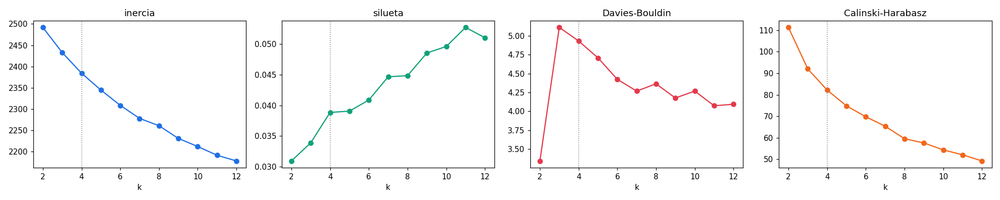
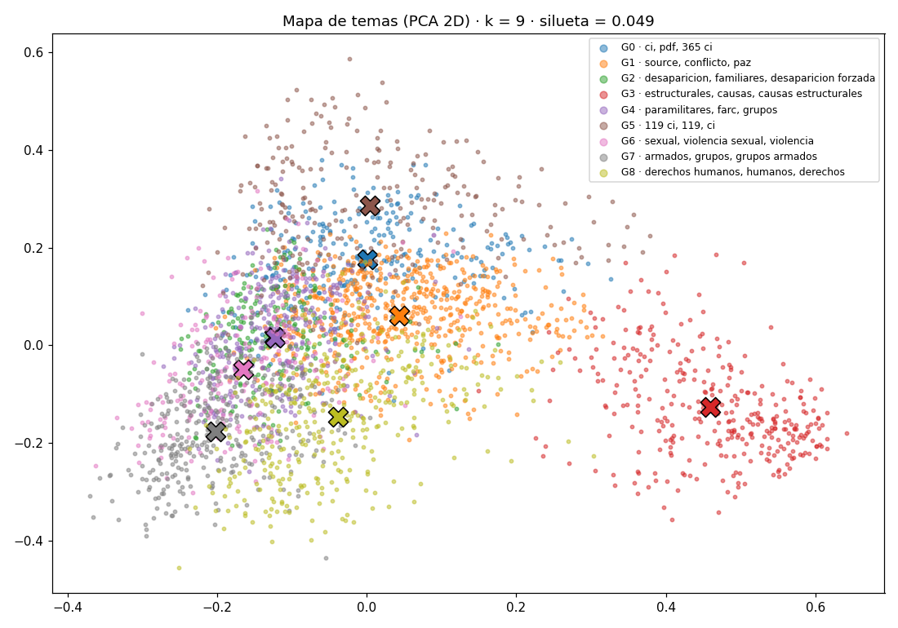
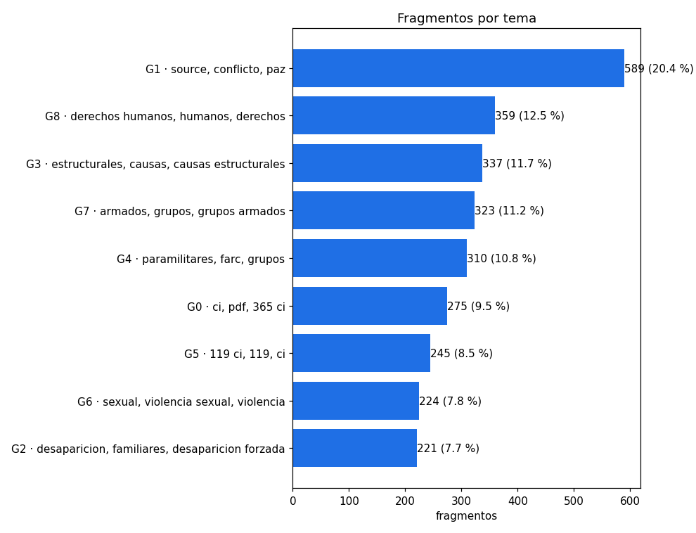

# Documento de hallazgos · EA3

_Generado automáticamente el 2026-11-08 22:48 (hora de Colombia) a partir de la ejecución del notebook._

## Pregunta de negocio
**¿Qué grandes temas aparecen en los fragmentos de informes sobre el conflicto armado colombiano, para que un centro de memoria histórica organice su archivo en colecciones temáticas y decida qué líneas pedagógicas y de atención a víctimas priorizar?**

- **Quién la necesita:** el equipo de archivo y pedagogía de un centro de memoria histórica (o una ONG de víctimas)
- **Qué decisión apoya:** cómo agrupar los documentos en colecciones y a qué temas dedicar primero recursos

## Respuesta corta
Los 2,883 fragmentos de informes se organizan en **9 grandes temas**.
Los tres más frecuentes reúnen el **45 %** del archivo:
**G1 · source, conflicto, paz** (20.4 %), **G8 · derechos humanos, humanos, derechos** (12.5 %), **G3 · estructurales, causas, causas estructurales** (11.7 %).

| Tema (nombre automático) | Fragmentos | Palabras que lo definen |
|---|---|---|
| G1 · source, conflicto, paz | 589 (20.4 %) | source, conflicto, paz, victimas, violencia, conflicto armado, armado, mujeres |
| G8 · derechos humanos, humanos, derechos | 359 (12.5 %) | derechos humanos, humanos, derechos, violaciones, violaciones derechos, conflicto, armado, forzado |
| G3 · estructurales, causas, causas estructurales | 337 (11.7 %) | estructurales, causas, causas estructurales, estructurales conflicto, repeticion, social, conflicto, recomendaciones |
| G7 · armados, grupos, grupos armados | 323 (11.2 %) | armados, grupos, grupos armados, amenazas, desplazamiento, forzado, ilegales, armados ilegales |
| G4 · paramilitares, farc, grupos | 310 (10.8 %) | paramilitares, farc, grupos, source, grupos paramilitares, armados, control, poblacion |
| G0 · ci, pdf, 365 ci | 275 (9.5 %) | ci, pdf, 365 ci, 365, 1306, 1306 ci, conflicto, 262 ci |
| G5 · 119 ci, 119, ci | 245 (8.5 %) | 119 ci, 119, ci, pdf, tierras, conflicto, comunidades, violencia |
| G6 · sexual, violencia sexual, violencia | 224 (7.8 %) | sexual, violencia sexual, violencia, mujeres, victimas, armados, testimonios, genero |
| G2 · desaparicion, familiares, desaparicion forzada | 221 (7.7 %) | desaparicion, familiares, desaparicion forzada, forzada, testimonios, casos, victimas, familias |

Los nombres salen de las palabras más importantes de cada grupo. El equipo de archivo debe revisarlos y ponerles un nombre definitivo.

## Hallazgos principales
1. **Temas dominantes.** El tema más grande (G1 · source, conflicto, paz) concentra el 20.4 % de los fragmentos, y el más pequeño (G2 · desaparicion, familiares, desaparicion forzada) el 7.7 %. El archivo no está repartido por igual: unos temas tienen mucho más material que otros.
2. **¿Cuántos temas?** Se probaron de 2 a 12 grupos. Con 9 se obtuvo la mejor separación entre las opciones útiles para organizar un archivo (silueta 0.049).
3. **Textos típicos de cada tema** (los más cercanos al centro del grupo):
- **G0:** _Hoy en día Puerto Gaitán se caracteriza por una economía de enclave basada principalmente en la industria petrolera【4:7†365-CI-00931.pdf】.…_
- **G1:** _Las fotografías y los murales en la Capilla de la Memoria no solo sirven para recordar a las personas asesinadas, sino que actúan como un mecanismo de denuncia y visibilidad sobre cómo opera la violencia en las comunas d…_
- **G2:** _Entre 1998 y 2005, el informe registra varios casos de desaparición forzada en Usme. Destaca el caso de la familia Muñoz, cuyo hijo adolescente fue desaparecido en octubre de 2002 tras haber sido presuntamente señalado d…_
- **G3:** _El informe identifica como causas estructurales del conflicto armado factores como la desigualdad socioeconómica, la ausencia efectiva del Estado, la exclusión de sectores vulnerables y la falta de acceso a servicios bás…_
- **G4:** _El informe describe la presencia y confrontación de distintos actores armados ilegales en Buenaventura, incluyendo las FARC-EP, el ELN y grupos paramilitares como las Autodefensas Unidas de Colombia (AUC), así como estru…_
- **G5:** _Informe 119-CI-00339…_
- **G6:** _Los testimonios recopilados reflejan que la violencia sexual fue utilizada de manera sistemática por actores armados como mecanismo de control, castigo y dominación sobre las mujeres. Se registraron casos de violación, a…_
- **G7:** _El informe describe que el desplazamiento forzado en el Bajo Cauca se ha dado tanto de forma masiva como de manera silenciosa y fragmentada. Las amenazas directas, la presencia de grupos armados ilegales y la violencia s…_
- **G8:** _El informe señala que la Armada de Colombia experimentó profundas transformaciones institucionales en respuesta a los desafíos derivados del conflicto armado interno. Entre los hallazgos principales se destaca la adaptac…_

## ¿Qué tan confiables son los resultados?
- **Silueta = 0.049** (va de -1 a 1): grupos débiles: muchos textos están en la frontera entre dos temas. En textos es normal que la silueta sea baja: un mismo informe habla de varios temas a la vez (por ejemplo, desplazamiento **y** despojo de tierras), así que muchos fragmentos quedan cerca de la frontera entre dos grupos.
- **Davies-Bouldin = 4.18:** más bajo es mejor. Sirve para comparar entre valores de k, no tiene un umbral absoluto.
- Los grupos se describen con palabras clave y ejemplos que una persona puede revisar, así que la agrupación es **verificable**.
- **Limitaciones:**
  - K-means asigna cada texto a **un solo** tema, aunque en la realidad tenga varios.
  - Supone grupos de forma "redonda" y de tamaño parecido.
  - TF-IDF cuenta palabras, pero no entiende su significado: dos fragmentos que dicen lo mismo con palabras distintas pueden quedar separados.
  - Los fragmentos son extractos cortos y el dataset no cubre todos los informes existentes.

## Recomendaciones
1. **G1 · source, conflicto, paz** (20.4 % del archivo): crear una colección temática con sus 589 fragmentos y usar sus textos típicos como punto de partida de una guía pedagógica o de una ruta de consulta para víctimas e investigadores.
2. **G8 · derechos humanos, humanos, derechos** (12.5 % del archivo): crear una colección temática con sus 359 fragmentos y usar sus textos típicos como punto de partida de una guía pedagógica o de una ruta de consulta para víctimas e investigadores.
3. **G3 · estructurales, causas, causas estructurales** (11.7 % del archivo): crear una colección temática con sus 337 fragmentos y usar sus textos típicos como punto de partida de una guía pedagógica o de una ruta de consulta para víctimas e investigadores.
4. Hacer que un equipo humano **revise una muestra de cada grupo** antes de publicar las colecciones, y ajuste los nombres y los textos mal ubicados.
5. Usar el modelo guardado (`.pkl`) para **clasificar automáticamente los fragmentos nuevos** en el tema más cercano a medida que crezca el archivo, y volver a entrenarlo cuando se agreguen muchos documentos.
6. Priorizar las líneas pedagógicas y de atención en los temas más grandes, sin descuidar los pequeños: pueden representar hechos menos documentados que merecen más investigación.
